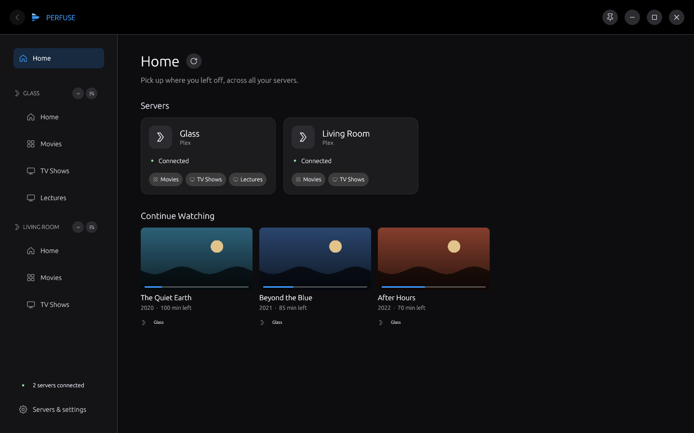

# Perfuse

Perfuse is an open-source Plex and Jellyfin player for Windows. Browse your libraries and play your original files directly on your PC.

**[Download for Windows x64](https://github.com/HammoTime/perfuse-video-player/releases/latest)**

## Features

- Connect Plex and Jellyfin servers together, see their connection status and continue watching across them from Home.
- Browse and search movie and TV libraries with poster art, synopses, seasons and episodes.
- Play the original file inside Perfuse with libmpv and FFmpeg. Choose a media version, audio track or embedded subtitle.
- Pick up where you left off with playback progress synced to the server you watched on.
- Seek within buffered video and read ahead up to five minutes, depending on your connection.

On first launch, review the licences and approve any playback library download. Choose **Plex** to sign in through your browser and select your servers. For **Jellyfin**, enter your server address and sign in with your username and password, or choose **Use Quick Connect** and enter the code on a signed-in Jellyfin device. After connecting, you can name the server and continue to Perfuse. To add another later, open **Settings → Servers → Add server**.

[Build and contribute](CONTRIBUTING.md) · [AGPL-3.0-only](LICENSE)
