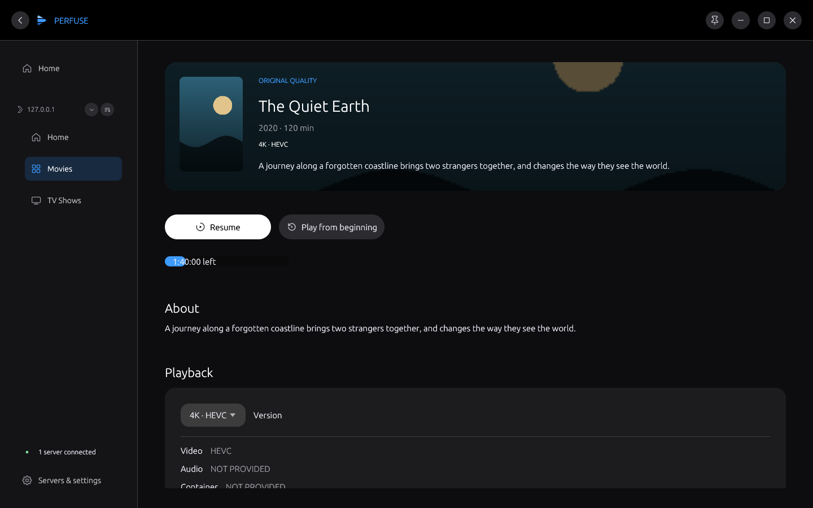

# Perfuse

Perfuse is an open-source Windows player for movies and TV from Plex and Jellyfin, and audiobooks from Audiobookshelf. Browse your libraries and play your original files directly on your PC.

**[Download for Windows x64](https://github.com/HammoTime/perfuse-video-player/releases/latest)**

## Features

- Connect several servers and pick up a film, episode or audiobook from Home.
- Browse and search movie and TV libraries with poster art, synopses, seasons and episodes.
- Listen while you browse with the docked audiobook player. Use its speaker button to adjust volume or mute. Perfuse remembers your volume across playback sessions and app restarts. The full player also has volume, chapter navigation, bookmarks, playback speed and a sleep timer.
- Play the original file inside Perfuse with libmpv and FFmpeg. Choose a media version, audio track or embedded subtitle.
- Sync your playback position with the server that holds the film, episode or book.
- Seek within buffered video and read ahead up to five minutes, depending on your connection.

On first launch, review the licences and approve any playback library download, then choose your server.

- **Plex** opens a browser for sign-in and lets you choose which servers to add.
- **Jellyfin** accepts your server address, username and password. You can also choose **Use Quick Connect** and enter the code on a signed-in Jellyfin device.
- **Audiobookshelf** accepts your server address and the username and password for your local Audiobookshelf account.

After connecting, you can name the server and open your libraries. To add another later, open **Settings → Servers → Add server**.

[Build and contribute](CONTRIBUTING.md) · [AGPL-3.0-only](LICENSE)
